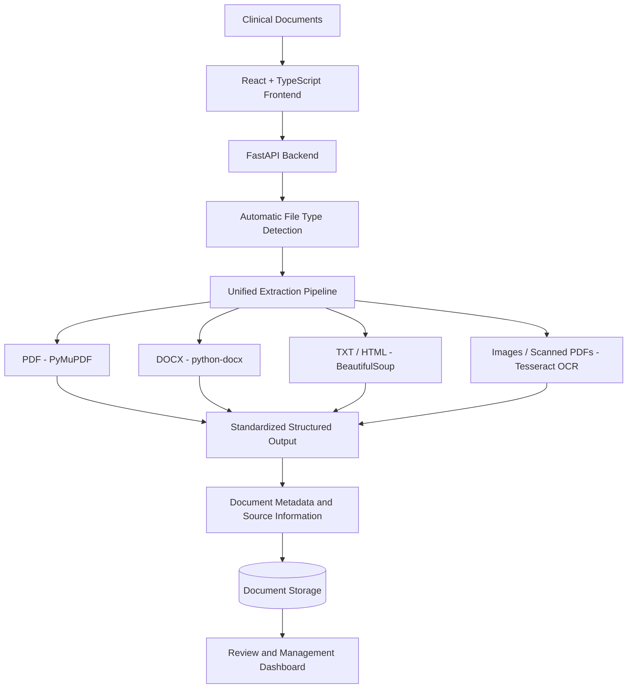
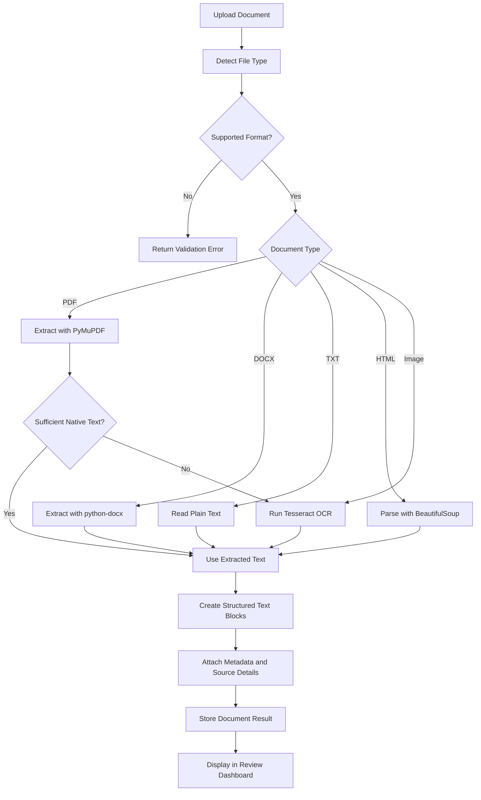

# 🏥 Clinical Document Intelligence Platform

### AI-Ready Clinical Document Extraction and Management System

A full-stack clinical document processing platform designed to extract, structure, manage, and review information from multiple document formats.

The system automatically detects document types, selects the appropriate extraction method, and converts extracted content into a standardized structured representation while preserving available metadata and source information.


##  Tech Stack & Badges


##  Project Overview

Clinical documents are available in multiple formats, including digital PDFs, scanned medical reports, Word documents, plain text files, and HTML pages.

Processing these documents manually can be time-consuming and difficult.

This platform provides a unified document extraction pipeline that automatically identifies document formats and extracts text using the appropriate processing technique.

It also provides a frontend dashboard for uploading documents, viewing extracted information, and managing document review workflows.

##  Key Features

- **Multi-Format Extraction:** Supports PDF, DOCX, TXT, HTML, PNG, JPEG, and TIFF.
- **Automatic File Detection:** Identifies uploaded file types using file information and content signatures.
- **Unified Extraction Pipeline:** Processes multiple document formats through a common extraction interface.
- **OCR Integration:** Uses Tesseract OCR for scanned images and scanned PDF pages.
- **Structured Output:** Converts extracted content into document, page, and text-block representations.
- **Metadata Preservation:** Retains available document properties and extraction information.
- **Source Traceability:** Preserves page numbers, source locations, bounding boxes, and OCR confidence where available.
- **Document Management:** Supports document listing, viewing, renaming, reviewing, archiving, and restoring.
- **REST API:** Provides document processing and management endpoints using FastAPI.
- **Interactive Dashboard:** Built with React, TypeScript, and Vite.


##  System Architecture



##  Document Extraction Workflow




##  Supported Document Formats

| Format | Extraction Technology | Description |
|--------|-----------------------|-------------|
| PDF | PyMuPDF | Extracts text from digital PDFs |
| DOCX | python-docx | Extracts Word document content |
| TXT | Python | Reads plain text documents |
| HTML | BeautifulSoup | Extracts readable HTML text |
| Scanned PDF | Tesseract OCR | Recognizes text in scanned PDF pages |
| PNG | Tesseract OCR | Extracts text from images |
| JPEG | Tesseract OCR | Extracts text from images |
| TIFF | Tesseract OCR | Extracts text from scanned images |


##  Project Structure

```text
clinical-ai-platform/
│
├── app/
│   ├── api/
│   │   ├── document_management.py
│   │   └── archive_model.py
│   │
│   ├── core/
│   │   ├── config.py
│   │   ├── database.py
│   │   └── models.py
│   │
│   ├── extractors/
│   │   ├── base.py
│   │   ├── pdf.py
│   │   ├── docx.py
│   │   ├── text.py
│   │   └── ocr.py
│   │
│   ├── services/
│   │   ├── detection.py
│   │   └── pipeline.py
│   │
│   └── main.py
│
├── test/
│   ├── test_api.py
│   ├── test_clinical_nlp.py
│   ├── test_phase12.py
│   ├── test_formats.py
│   └── test_document_management.py
│
└── README.md
```

The frontend is maintained separately within the project workspace.


##  API Endpoints

| Method | Endpoint | Description |
|--------|----------|-------------|
| GET | `/health` | Check backend health |
| POST | `/api/v1/documents` | Upload and process documents |
| GET | `/api/v1/documents` | List documents |
| GET | `/api/v1/documents/{document_id}` | Retrieve document details |
| PATCH | `/api/v1/documents/{document_id}/metadata` | Update document metadata |
| PATCH | `/api/v1/documents/{document_id}/entities/{index}` | Correct an extracted entity |
| POST | `/api/v1/documents/{document_id}/review` | Submit document review decision |
| POST | `/api/v1/documents/{document_id}/review-status` | Update review status |
| GET | `/api/v1/documents/{document_id}/original` | Retrieve original document |
| DELETE | `/api/v1/documents/{document_id}` | Archive a document |
| GET | `/api/v1/documents/archived/list` | List archived documents |
| POST | `/api/v1/documents/{document_id}/restore` | Restore an archived document |

Interactive API documentation is available at:

`http://127.0.0.1:8000/docs`


##  Installation and Setup

### 1. Clone the Repository

```bash
git clone https://github.com/YOUR_USERNAME/clinical-document-intelligence-platform.git
cd clinical-document-intelligence-platform
```

Replace `YOUR_USERNAME` with your GitHub username.

### 2. Create a Python Virtual Environment

```powershell
python -m venv .venv
.\.venv\Scripts\Activate.ps1
```

### 3. Install Backend Dependencies

```powershell
pip install -r requirements.txt
```

### 4. Install Tesseract OCR

Install Tesseract OCR and ensure the executable is available on your system PATH.

Example Windows installation path:

```text
C:\Program Files\Tesseract-OCR
```

### 5. Configure Backend Environment

Set your API key through an environment variable:

```powershell
$env:CLINICAL_API_KEY = "your-local-development-key"
```

Do not commit real API keys or secrets to GitHub.

### 6. Start the Backend

```powershell
python -m uvicorn app.main:app --reload
```

Backend URL:

`http://127.0.0.1:8000`

### 7. Start the Frontend

Open a new terminal, navigate to the frontend directory, and run:

```powershell
npm install
npm run dev
```

Frontend URL (default Vite configuration):

`http://localhost:5173`


##  Testing and Validation

The backend was tested using Pytest.

Run the automated tests:

```powershell
python -m pytest -q .\test
```

### Latest Local Test Results

| Metric | Result |
|--------|--------|
| Total Tests | 22 |
| Passed | 22 |
| Failed | 0 |
| Warnings | 1 |
| Execution Time | 3.88 seconds |

All 22 automated tests passed during local development.

Frontend routes and document management features were also manually tested.

**Note:** The badge above reflects a local test result, not a continuously running CI pipeline.


##  Known Limitations

- OCR accuracy depends on image resolution and scan quality.
- Mixed-content PDFs may contain scanned text that is not captured by the current OCR fallback.
- DOCX extraction does not preserve exact rendered page numbers.
- Metadata availability depends on the source document format.
- Clinical extraction results should be reviewed before use in high-stakes workflows.


##  Future Improvements

- Improve extraction from mixed text-and-image PDF pages.
- Enhance OCR preprocessing and extraction accuracy.
- Add more comprehensive extraction quality evaluations.
- Improve clinical entity recognition and validation.
- Introduce CI/CD pipelines and automated deployment checks.
- Expand document search and retrieval functionality.

